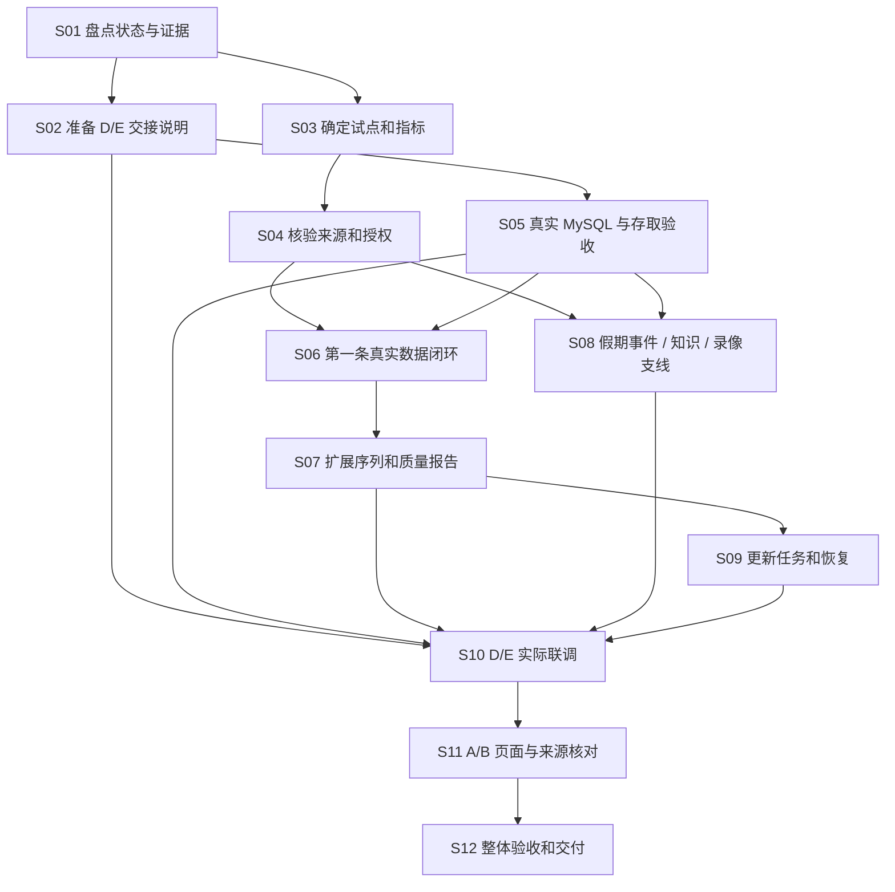
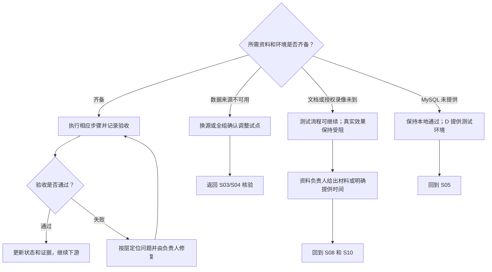

# 项目完成图总表

版本：0.2；首次盘点及实装复核：2026-10-11。对应[完整实施路线图](./05-项目完整实施路线图.md)。本表随实际证据更新。本轮完成交接材料与合成样例，补登记代码与目标设计的接口差异；未将接收方或真实业务验收标为通过。

## 1. 项目完成图

箭头表示需要前一项提供输入，不要求等待该成员所有工作结束。同一层的资料整理、算法开发和接口适配可以并行；最终通过要有完整验收记录。

### 遇阻时的分支

## 2. 状态和证据口径

- **本地通过：**C 的测试与样例证据，仅覆盖注明的范围。
- **文档声明，待核验：**D/E 往来称已实现，当前未核查其最新仓库或实际调用。
- **接收方待验收：**C 已提供存储/契约，仍需 D/E 环境实调。
- **待核验：**没有本地代码或接收方证据；不推断为未开发。
- **未完成/受阻：**尚缺真实资料、环境或待实现产物。
- **端到端通过：**页面、API、处理、存储、来源连通，并留下实际验收记录。

证据 A：[C 第一版交付记录](./data_foundation/07-第一版交付记录.md)、当前 C 代码与测试。此次重新运行 `./.venv/bin/python -m pytest data_foundation/tests -q`，6 项通过。

证据 B：[C 调用契约](./data_foundation/04-DE调用契约.md)和实际 `create_store` / auth 方法。契约包含后续扩展，未实现能力仍需以代码为准。

证据 C：用户提供的 E《回复 D》《接口与数据需求确认清单》及 D《函数契约确认与路由映射》。E 声明 v0.4.0、提交 3cef391、26 测试通过；D 声明 40 测试通过。上述文档声明不计入本地重新验证结果。D 文档仍把六条 E 路由实接列为待办。

证据 D：[全组分工与验收要求](./02-个人分工与验收要求.md)。A/B/D/E 当前完整代码不在本地仓库，缺证据时保持待核验。

证据 E：[C→D/E 交接说明](./data_foundation/08-C到DE交接说明与实调样例.md)、[可运行样例](./data_foundation/examples/de_handoff_smoke.py)与[实装核对清单](./data_foundation/09-接口实装核对与缺口清单.md)。原版 18 项有 D SQLite 回执及 MySQL 缺陷反馈；0.1.1 精度修复后本地 21 项通过，D 新版 MySQL 复验、E/HTTP/真实算法仍待取得。

## 3. 功能与交付总表

同一功能的存储、资料、接口和页面分行记录，防止“C 包通过”被误写为全功能通过。

| 编号 / 路线 | 工作项及负责人 | 前置输入 | 当前状态与证据 | 完成判据 | 下一动作 |
|---|---|---|---|---|---|
| P01 / S01 | 项目盘点；C 汇总，全员核验 | 版本和运行证据 | 进行中：本表首版已建立；A/B 最新状态待取得 | 全功能有状态、负责人和证据 | 补各成员当前版本与调用结果 |
| P02 / S02 | C→D/E 交接说明；C | C 包、契约、样例 | 0.1.1 修复包就绪、21 项本地通过；D 待复验、E 待验收；证据E | 安装/调用样例在接收方可执行 | 用户发送 08/09 与配套文件，D/E 运行并填写回执 |
| P03 / S05 | 用户与会话存储；C，D 接入 | MySQL、C 包 | C 本地通过；D 适配待验收；证据A、B | 保存、有效查询、撤销/到期行为实测正确 | D 使用工作单元内的 auth 方法实调 |
| P04 / S03 | 实体与指标范围；C，全组确认 | 试点名单、口径 | 五指标已定义；实体台账为空；证据A | 固定 ID、真实可用粒度和日期清楚 | 核验首批景区及交通对象 |
| P05 / S04 | 来源和原件台账；C，资料提供者 | 官方资料与使用依据 | 真实资料未完成；来源台账为空；证据A | 每项正式数据可定位原件和使用条件 | 核验来源并登记原件 |
| P06 / S05 | 包与数据库迁移；C，D 提供 MySQL | 测试 MySQL、配置 | 9 项本地测试通过；D 报告旧版 MySQL 精度缺陷，0005 修复后待复验；证据A、E | 空 MySQL 迁移及 doctor 通过 | D 环境安装、迁移并保存结果 |
| P07 / S06 | 第一条真实数据闭环；C、D | P04—P06 | 导入/查询本地通过；真实数据未交付；证据A | 官方原件→记录→接口→原件可追溯 | 完成第一条核验观测 |
| P08 / S07 | 景区与交通真实序列；C | P07、更多周期资料 | 未完成；证据A | 实际范围、缺期、口径明确 | 扩展各试点序列，分别报告铁路/机场取得情况 |
| P09 / S07 | 完整质量报告；C | P08、检查规则 | 数量摘要已有，完整报告待补；证据A | 缺期、连续段、冲突、异常和追溯情况可查 | 输出 JSON/Markdown 覆盖报告 |
| P10 / S08 | 假期与官方事件；C 整理，D 服务化 | 日期定义、公告原件 | 最小存储本地通过；真实资料/HTTP 待验收；证据A、D | 日期与公告可追溯，变更留痕、过期状态正确 | 提供真实定义和公告，联调读写 |
| P11 / S08 | 官方知识资料；C、资料提供者 | 文档及有效期/使用条件 | 真实资料未交付；证据A | 至少两份可用官方资料带完整元数据 | 取得并核验资料，逐项反馈 E |
| P12 / S08 | 文档与索引存取；C，E 处理 | P06、文档/测试样例 | 顺序写入/激活/读回本地通过；详情/列表/失败接口未实现；证据E | 片段写入、激活、读回及完整失败生命周期 | E/D 先跑样例，C 补 G04/G09/G10 |
| P13 / S10 | RAG 问答与引用；E、D、B | P11/P12、指标查询 | E 算法文档声明；真实效果/接口/页面待验收；证据C | 回答引用真实文档，证据不足明确提示 | D 接实函数，E 用真实资料验证 |
| P14 / S04/S08 | 视频授权、入口及人工标注；C、资料提供者 | 获准录像、现场方向、人工统计 | 真实材料未交付；证据A | 授权范围、录制时间、进入方向、标注版本完整 | 协调一个可用片段及人工样本 |
| P15 / S08 | 视频分析与计数存储；C，E 写结果 | P06/P14 或测试资料 | 顺序登记/写读本地通过；视频/回放读取及失败/标注接口缺失；证据E | 同窗去重/冲突拒绝、完整业务读取与授权校验 | E/D 跑存储样例；C 补 G05/G06/G09/G10 |
| P16 / S08/S10 | 录像检测、跟踪与误差评估；E | P14/P15、权重/推理环境 | E 算法文档声明；真实效果待验收；证据C | 方向校准，模型/配置留痕，有人工误差报告 | 实测授权片段并核对人工统计 |
| P17 / S08/S10 | 入口短时预测；E，C 保存，D/B 接入 | 连续计数、截止时间 | C 不足保存/cutoff 顺序检查通过；run 读取/完整校验待补；E 实际效果待验收；证据C、E | 截止前输入、质量/不足状态正确、结果可复现 | C 补 G07/G18；E 用真实计数实测 |
| P18 / S07/S10 | 历史周/月预测；D，C 提供序列与保存 | P08/P09 | C 不足状态保存通过；run 读取/完整校验待补；D 算法待核验；证据D、E | 训练窗口、模型版本、回测与区间可追溯 | C 补 G07/G18；D 判断样本量并回测 |
| P19 / S09/S10 | Worker 与作业租约；D 主进程，C/E 提供能力 | 作业接口、处理函数 | 顺序领取/续约/完成/失败通过；恢复/重试/进度及完整归属锁保护未实现；证据E | 唯一领取方，失败/重试/过期 token 行为正确 | D/E 确认调用链；C 补 G08/G09 后验收恢复 |
| P20 / S09 | 官方来源更新与周检查；C/D | P05/P07/P19 | 首个官方适配器及调度接入未完成；证据A | 检查/获取/解析/入库可重复，无更新记录真实 | 实现首个适配器，保留人工导入路径 |
| P21 / S10 | 全部 HTTP、鉴权和状态映射；D | C/E 包、契约 | D 模型/测试文档声明；实接与运行待核验；证据C | 接口实调、权限、错误/不足状态符合契约 | D 接实六条 E 路由并与 C/E 验收 |
| P22 / S10 | 智能体受约束指标查询；D 注入，C 定范围，E 调用 | P04/P08/P21 | 方案确认，实际注入待验收；证据C | 只查白名单参数，数值带来源/周期/单位 | C 给真实范围，D 实现包装查询 |
| P23 / S11 | 登录/总览/景区/假期等前端；A/B | P21 与真实数据 | 当前版本和运行证据待核验；证据D | 页面可运行、登录态和空/错/不足状态正确 | 取得 A/B 版本，联调并抽样追溯 |
| P24 / S11 | 问答和录像回放页面；B，D/E 配合 | P13/P16/P17/P21 | 前端/回放实现待核验；证据D | 引用可定位，Range 回放获准，录制时间/计数口径明确 | B/D 实测页面、回放与状态 |
| P25 / S12 | 空库重建、升级和备份恢复；C/D | 稳定包/迁移、DB 与资产副本 | 本地空库测试有；实际升级/恢复待演练；证据A | 恢复后数据及引用原件均可用 | 在测试副本演练并留记录 |
| P26 / S12 | 全组演示与最终交付；全员 | 上述正式范围各项验收 | 未开始整体最终验收；证据D | 完整用户路径、追溯、复现及局限说明齐备 | 随完成证据更新，失败回到对应项 |

## 4. 当前阻塞清单与分支

| 编号 | 阻塞事项 | 牵涉项目 | 解决动作 / 谁配合 | 没解决时保持什么状态 |
|---|---|---|---|---|
| B01 | C 与 D 认证访问方式及方法名不同 | P02/P03/P21 | C 给实际样例，D 适配工作单元内 auth | C 本地通过，D 接收方待验收 |
| B02 | D 已确认唯一 Worker 分工，E 入口与责任确认待取得 | P12/P15/P19/P20 | D/E 确认唯一 Worker 领取方及 E 处理入口，C 提供事务/租约约束 | D 侧分工确认，E 待确认；后台联调未完成 |
| B03 | 实体与来源台账为空 | P04/P05/P07/P08 | 全组给试点对象，C 核验来源并登记 | 真实业务数据未完成 |
| B04 | 官方知识文档未提供 | P11/P13 | 资料负责人提供，C 核验元数据，E 接入 | 流程可测，真实问答效果受阻 |
| B05 | 授权录像与人工标注未提供 | P14/P16/P17/P24 | 提供者确认权限/片段，C/E 校准方向和人工样本 | 测试流程可测，真实计数与误差受阻 |
| B06 | D 已提供原版 MySQL 缺陷记录，新版及 E 实调仍待取得 | P06/P10/P12/P15/P21 | D 提供测试环境，D/E 运行样例并记录 | 接收方待验收 |
| B07 | A/B 当前实现证据未取得 | P23/P24 | A/B 提供版本、运行入口和接口核对记录 | 待核验，不推断为未开发 |
| B08 | 目标契约存在尚未实装的方法，部分实际签名不同 | P10/P12/P15/P19/P21/P24 | D/E 先按 08/09 使用实际入口；C 补详情、回放、失败、恢复等缺口 | 最小存储流程可验收，完整路由/生命周期未完成 |
| B09 | 完整质量、跨任务归属、授权重验、并发与预测校验未完成 | P07/P09/P12/P15/P17/P18/P19 | C 按 G09/G10/G14/G18 补实现与真实 MySQL 检查 | 顺序合成样例通过不升级为完整隔离/正确性通过 |

## 5. 阶段通过条件

- [ ] **范围明确：**试点对象、来源、指标、粒度和使用边界经确认（P04/P05/P14）。
- [ ] **C→D/E 依赖可用：**安装、真实 MySQL、认证、知识/录像/预测写读在接收方环境通过（P02/P03/P06/P12/P15/P19）。
- [ ] **真实数据可用：**序列、文档、授权录像与人工样本符合正式范围；质量和算法报告有证据（P07—P18）。
- [ ] **服务能运行：**Worker、更新、HTTP、权限和指标查询实调通过（P19—P22）。
- [ ] **用户路径可用：**A/B 页面正确展示来源、单位、时间、引用和不足状态（P23/P24）。
- [ ] **可复现交付：**升级、恢复、整体验收和已知限制齐备（P25/P26）。

不计算一个混合百分比：存储本地通过、资料取得、接收方联调和整体验收具有不同含义。更新时把实际证据写入对应行，未确认事项保持原状态。

## 6. D 回执后的修复进展（2026-10-11）

详见[0.1.1 修复与 D 复验步骤](./data_foundation/10-MySQL时间精度修复与回复D.md)。新增迁移 0005 覆盖 77 个时间列；本地 9 项测试、21 项样例通过。D 对旧版的微秒截断通过报告不升级为新版 MySQL 通过。H04 后续顺序：文档详情/列表 → 作业类型与 ID 过滤 → 视频读取/回放 → 事件筛选。

### 第二轮复核补充

C 已在独立临时 MySQL 8.4.11 上，从交接包解压目录完成 all 21 项、d/e 各 13 项验证，并检查已有 0004 测试库升级到 0005：77 个时间列均为 6 位精度、原测试行保留、新写入微秒准确读回。临时实例已关闭。C 真实 MySQL 合成存储通过，D Windows 新版复验、E/HTTP/真实资料仍待完成。证据见 data_foundation/acceptance/C-0.1.1-mysql/。
