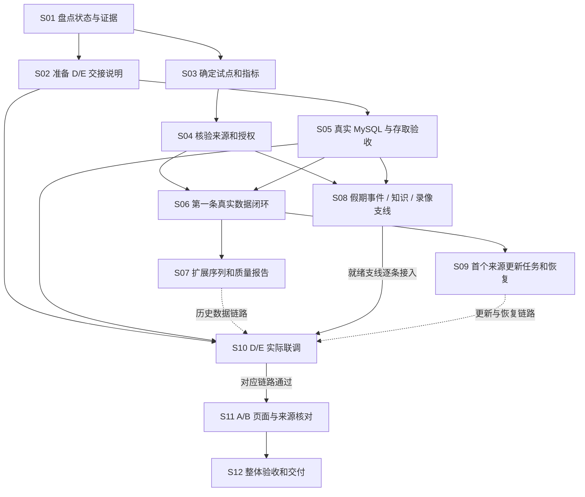
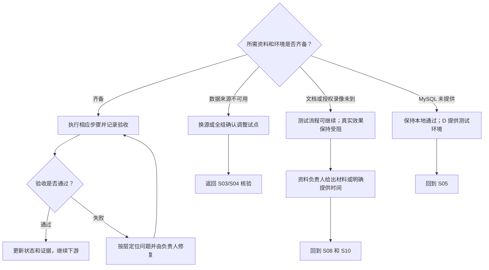

# 项目完成图总表

版本：0.12；修订日期：2026-10-14（北京时间）。当前C0.1.9 / 0006新增周期/数值/换算及同来源修订已独立验收，真实资料沿用H。D/E正式接收、HTTP/Worker及页面仍待回传；旧版验收不代替新版接收。下方I/J及旧记录为对应版本历史，以N为最新C证据。

当前阶段：**四对象已固定，首批真实观测与资料已交付；S06在C独立库通过，S07覆盖仍不完整，S08/S10等待D/E正式库和索引联调。**详见[本轮交付记录](./data_foundation/12-首批真实数据交付与验收.md)。

> 最新公开补充证据 H：C 0.1.3，26项测试与独立MySQL/SQLite通过；新增26个全国假期窗口、1条历史事件、10份文档、4条景区公布事实。累计16份知识文档，但E索引尚未建立。景区新增数字范围待确认，不提升S07连续序列完成状态。详见[公开补充记录](./data_foundation/13-公开资料补充与剩余缺口.md)。旧版本G证据及D接收记录保留。

> 最新执行证据 I（2026-10-13）：C 0.1.4 的G08类型/ID领取筛选完成，55项测试、MySQL领取5项、MySQL/SQLite旧调用各21项通过。进度更新、恢复/重试仍缺；S09/S10整体仍待验收，S07/S08资料状态沿用H。见[本步交付](./data_foundation/14-任务领取筛选与014交接.md)。

> 最新执行证据 J（2026-10-13）：C 0.1.5过期恢复和租约写锁完成，91项pytest、MySQL恢复竞争6项及领取回归5项通过；G08进度/手动重试、业务处理幂等、S09调度与S10正式联调继续待验收。资料沿用H。见[本步交付](./data_foundation/15-过期任务恢复与015交接.md)。

> 最新执行证据K（2026-10-14）：C0.1.6 / 0006任务生命周期及索引/分析归属完成；154项SQLite、63项MySQL、8项竞争及旧版回归通过，旧0005数据升级保留。S09正式调度/S10真实联调仍待D/E接收；资料沿用H，授权录像、人工标注及连续观测缺口不变。见[交接](./data_foundation/16-任务生命周期与016交接.md)。

> 最新执行证据L（2026-10-14）：C0.1.7补G05标注/G06整窗聚合/G07读取；188项SQLite、97项MySQL、标注竞争6项和生命周期8项通过，资料沿用H，D/E正式接收待回传。见[交接](./data_foundation/17-分析读取与017交接.md)。

> 最新执行证据M（2026-10-14）：C0.1.8补G11策略能力和G12覆盖/截止/假期证据；210项SQLite、22项MySQL及6项策略/真实快照检查通过。两机场各44应有/41可用/连续11月，资料沿用H，D/E正式接收待回传。见[交接](./data_foundation/18-覆盖报告与018交接.md)。

> 最新执行证据N（2026-10-14）：本轮连续C0.1.6—0.1.9补任务/标注/覆盖/写入加固。242项SQLite、54项MySQL、质量5项及旧回归通过，资料沿用H，人工审批/索引产物/完整预测与D/E正式接收仍待完成。见[最新交接](./data_foundation/19-观测质量与019交接.md)。

> 2026-10-14下一版启动：已建立[C v0.2.0计划](./data_foundation/20-v020启动计划.md)，先补G10产物校验并推进D/E新版接收，再补G18预测保存验证和真实知识链路。此为计划，尚无0.2.0实现/验收证据；C当前交付仍为0.1.9。下表早期证据及版本记录保留，最新C实装以N和09缺口清单为准。

## 1. 项目完成图

箭头表示需要前一项提供输入，不要求等待该成员所有工作结束。同一层的资料整理、算法开发和接口适配可以并行；最终通过要有完整验收记录。

### 遇阻时的分支

## 2. 状态和证据口径

- **本地通过：**C 的测试与样例证据，仅覆盖注明的范围。
- **接收方存储通过：**在 D/E 环境使用 C 包实际读写通过；不包含未验收的 HTTP、真实资料和页面。
- **文档声明，待核验：**D/E 往来称已实现，当前未核查其最新仓库或实际调用。
- **接收方待验收：**C 已提供存储/契约，仍需 D/E 环境实调。
- **待核验：**没有本地代码或接收方证据；不推断为未开发。
- **未完成/受阻：**尚缺真实资料、环境或待实现产物。
- **端到端通过：**页面、API、处理、存储、来源连通，并留下实际验收记录。

证据 A：[C 第一版交付记录](./data_foundation/07-第一版交付记录.md)、当前 C 代码与测试。首次盘点曾运行 `./.venv/bin/python -m pytest data_foundation/tests -q`，6 项通过；0.1.1 后续本地 9 项结果见验收目录，本次文档修订未重新运行测试。

证据 B：[C 调用契约](./data_foundation/04-DE调用契约.md)和实际 `create_store` / auth 方法。契约包含后续扩展，未实现能力仍需以代码为准。

证据 C（早期）：用户提供的 E/D 首轮确认文档，曾声明 E 26 项/D 40 项测试及六路由待接。今晚最新进展以证据 F 为准；文档声明不计入本地重新验证结果。

证据 D：[全组分工与验收要求](./02-个人分工与验收要求.md)。A/B/D/E 当前完整代码不在本地仓库，缺证据时保持待核验。

证据 E：[C→D/E 交接说明](./data_foundation/08-C到DE交接说明与实调样例.md)、[可运行样例](./data_foundation/examples/de_handoff_smoke.py)与[实装核对清单](./data_foundation/09-接口实装核对与缺口清单.md)。原版 18 项有 D SQLite 回执及 MySQL 缺陷反馈；0.1.1 精度修复后本地 21 项通过，D 新版 SQLite/MySQL 21 项复验已收到；E 新版/正式 C 库 HTTP/真实算法仍待取得。

证据 F（今晚）：[晚间对接汇总](./data_foundation/11-晚间对接汇总与下一步.md)及其三份原材料链接。D 对 0.1.1 原样 SQLite/MySQL 各 21 项 JSON 一致，升级路径由 D 回执确认；D 声明 69 项测试和六路由/Worker 桥接闭环，E 声明 34 项测试及旧版 C 集成，本轮未独立重跑其代码。

证据 G（12日实际执行）：[真实数据交付记录](./data_foundation/12-首批真实数据交付与验收.md)、[覆盖报告](./data_foundation/real_data/2026-10-12/quality_report.md)及其18项测试、独立MySQL/SQLite证据。83条日/月观测、13条原粒度补充事实、6份资料和文档详情/列表已交付；连续12个月、景区/铁路月报、指定政府公告及正式HTTP/Worker/E索引仍未验收。

## 3. 功能与交付总表

同一功能的存储、资料、接口和页面分行记录，防止“C 包通过”被误写为全功能通过。

| 编号 / 路线 | 工作项及负责人 | 前置输入 | 当前状态与证据 | 完成判据 | 下一动作 |
|---|---|---|---|---|---|
| P01 / S01 | 项目盘点；C 汇总，全员核验 | 版本和运行证据 | 进行中：本表首版已建立；A/B 最新状态待取得 | 全功能有状态、负责人和证据 | 补各成员当前版本与调用结果 |
| P02 / S02 | C→D/E 交接说明；C | C 包、契约、样例 | D 0.1.1旧验收保留；新0.1.2真实数据包已本地通过，D/E接收方待确认；证据G | 安装/调用样例在接收方可执行 | D/E安装0.1.2/0005，执行真实数据与文档调用并回传结果 |
| P03 / S05 | 用户与会话存储；C，D 接入 | MySQL、C 包 | C/D 合成认证存储通过；D 正式 HTTP auth 适配 H01 待验收；证据A、B、E、F | 保存、有效查询、撤销/到期行为实测正确 | D 包装工作单元 auth，验证正式登录/退出/过期 HTTP 链路 |
| P04 / S03 | 实体与指标范围；C，全组确认 | 试点名单、口径 | 四对象固定ID，五指标不变；普通与补充粒度区分；证据G | 固定 ID、真实可用粒度和日期清楚 | D/E按manifest名单和实际能力接入 |
| P05 / S04 | 来源和原件台账；C，资料提供者 | 官方资料与使用依据 | 96份原件和来源登记，未取得公告/许可未知单列；证据G | 每项正式数据可定位原件和使用条件 | 继续补缺期、使用依据和指定公告 |
| P06 / S05 | 包与数据库迁移；C，D 提供 MySQL | 测试 MySQL、配置 | C/D MySQL 8.4.11 验证通过，D 原样 21 项与升级路径确认；证据E、F | 空 MySQL 迁移及 doctor 通过 | 本次精度缺陷关闭，后续版本保留回归 |
| P07 / S06 | 第一条真实数据闭环；C、D | P04—P06 | C独立MySQL/SQLite导入83条、幂等与五条查询追溯通过；D HTTP待验收；证据G | 官方原件→记录→接口→原件可追溯 | D导入正式库并接HTTP |
| P08 / S07 | 景区与交通真实序列；C | P07、更多周期资料 | 部分交付：两机场各41个月值、铁路1日值；景区年/季与铁路半年另存；证据G | 实际范围、缺期、口径明确 | 补机场12月及景区/铁路月报，不能宣称连续12个月通过 |
| P09 / S07 | 完整质量报告；C | P08、检查规则 | 本批JSON/Markdown覆盖、连续段、歧义核验、追溯及缺口报告已交；通用异常/并发规则仍待补；证据G | 缺期、连续段、冲突、异常和追溯情况可查 | D据报告判断训练窗口，C继续补通用质量规则 |
| P10 / S08 | 假期与官方事件；C 整理，D 服务化 | 日期定义、公告原件 | 最小存储本地通过；真实资料/HTTP 待验收；证据A、D | 日期与公告可追溯，变更留痕、过期状态正确 | 提供真实定义和公告，联调读写 |
| P11 / S08 | 官方知识资料；C、资料提供者 | 文档及有效期/使用条件 | 6份资料：民航局2、企业正式披露3、铁路报道1；原件/TXT/元数据齐，指定运营公告未取得；证据G | 至少两份可用官方资料带完整元数据 | E按manifest解析真实资料，保留历史适用周期与来源类别 |
| P12 / S08 | 文档与索引存取；C，E 处理 | P06、文档/测试样例 | 详情/列表已在C独立MySQL/SQLite通过；E索引/失败生命周期继续待验收；证据G | 片段写入、激活、读回及完整失败生命周期 | D/E接0.1.2读取接口，E建立真实索引，C补失败生命周期 |
| P13 / S10 | RAG 问答与引用；E、D、B | P11/P12、指标查询 | D声明桥接问答闭环；真实资料已交，E索引/正式C库/页面仍待联调；证据F、G | 回答引用真实文档，证据不足明确提示 | E索引已交资料，D切正式store，E/B验证引用 |
| P14 / S04/S08 | 视频授权、入口及人工标注；C、资料提供者 | 获准录像、现场方向、人工统计 | 真实材料未交付；证据A | 授权范围、录制时间、进入方向、标注版本完整 | 协调一个可用片段及人工样本 |
| P15 / S08 | 视频分析与计数存储；C，E 写结果 | P06/P14 或测试资料 | 顺序登记/写读本地通过；视频/回放读取及失败/标注接口缺失；证据E | 同窗去重/冲突拒绝、完整业务读取与授权校验 | D 存储样例已通过，E 补新版确认；C 补 G05/G06/G09/G10 |
| P16 / S08/S10 | 录像检测、跟踪与误差评估；E | P14/P15、权重/推理环境 | E 算法文档声明；真实效果待验收；证据C | 方向校准，模型/配置留痕，有人工误差报告 | 实测授权片段并核对人工统计 |
| P17 / S08/S10 | 入口短时预测；E，C 保存，D/B 接入 | 连续计数、截止时间 | C 不足保存/cutoff 顺序检查通过；run 读取/完整校验待补；E 实际效果待验收；证据C、E | 截止前输入、质量/不足状态正确、结果可复现 | C 补 G07/G18；E 用真实计数实测 |
| P18 / S07/S10 | 历史周/月预测；D，C 提供序列与保存 | P08/P09 | C 不足状态保存通过；run 读取/完整校验待补；D 算法待核验；证据D、E | 训练窗口、模型版本、回测与区间可追溯 | C 补 G07/G18；D 判断样本量并回测 |
| P19 / S09/S10 | Worker 与作业租约；D 主进程，C/E 提供能力 | 作业接口、处理函数 | D 运行 E AnalysisWorker 的桥接闭环已声明通过；0.1.6进度/审计重试、0.1.4领取及0.1.5恢复在C独立MySQL通过；正式C jobs切换与实际处理幂等待接收；证据E、F、I、J、K | 唯一领取方，失败/重试/过期 token 行为正确 | D升级0006并接最新0.1.9，联合验收真实处理、管理员权限及新旧租约 |
| P20 / S09 | 官方来源更新与周检查；C/D | P05/P07/P19 | 公开来源清单获取、PDF解析/标准化与显式导入可复现；D周调度仍未接，sources未启用；证据G | 检查/获取/解析/入库可重复，无更新记录真实 | 接D唯一Worker及周检查，补无更新/修订/失败生命周期 |
| P21 / S10 | 全部 HTTP、鉴权和状态映射；D | C/E 包、契约 | D 回执六条 E 路由实调和 69 项测试通过；使用桥接库，H01/完整 HTTP 待验收；证据F | 接口实调、权限、错误/不足状态符合契约 | D 适配 C 正式 store/认证并提交完整链路证据 |
| P22 / S10 | 智能体受约束指标查询；D 注入，C 定范围，E 调用 | P04/P08/P21 | 字典0.1.0；C已交实体/可用粒度/覆盖，D注入仍待完成；证据F、G | 只查白名单参数，数值带来源/周期/单位 | D按manifest实现注入，E验证数值问答与不足状态 |
| P23 / S11 | 登录/总览/景区/假期等前端；A/B | P21 与真实数据 | 当前版本和运行证据待核验；证据D | 页面可运行、登录态和空/错/不足状态正确 | 取得 A/B 版本，联调并抽样追溯 |
| P24 / S11 | 问答和录像回放页面；B，D/E 配合 | P13/P16/P17/P21 | 前端/回放实现待核验；证据D | 引用可定位，Range 回放获准，录制时间/计数口径明确 | B/D 实测页面、回放与状态 |
| P25 / S12 | 空库重建、升级和备份恢复；C/D | 稳定包/迁移、DB 与资产副本 | C/D 空库和 0004→0005 测试升级通过；备份恢复仍待演练；证据E、F | 恢复后数据及引用原件均可用 | 另在测试副本演练数据库与资产共同恢复 |
| P26 / S12 | 全组演示与最终交付；全员 | 上述正式范围各项验收 | 未开始整体最终验收；证据D | 完整用户路径、追溯、复现及局限说明齐备 | 随完成证据更新，失败回到对应项 |

## 4. 当前阻塞清单与分支

| 编号 | 阻塞事项 | 牵涉项目 | 解决动作 / 谁配合 | 没解决时保持什么状态 |
|---|---|---|---|---|
| B01 | D 正式 auth 适配 H01 未完成 | P03/P21 | D 按 0.1.1 工作单元方法适配并验证登录接口 | C 存储验收通过，登录 HTTP 待验收 |
| B02 | D/E Worker 桥接已跑通，C 正式 jobs 切换未完成 | P12/P15/P19/P20 | D 单进程运行 E AnalysisWorker，切 C 后核对领取/心跳/失败及发布事务 | 分工已明确；正式 C/MySQL Worker 联调待完成 |
| B03 | 机场12月及景区/铁路月报缺失 | P04/P05/P07/P08 | 已登记四对象与首批来源；继续取得缺期，不拆年/半年值补月 | 首批真实数据已交，月度覆盖完整验收未通过 |
| B04 | 已交资料尚未由E建索引；指定运营公告未取得 | P11/P13 | E先解析6份资料中的正式原件，C继续补公告 | 真实资料已就绪，真实问答/引用仍待联调 |
| B05 | 授权录像与人工标注未提供 | P14/P16/P17/P24 | 提供者确认权限/片段，C/E 校准方向和人工样本 | 测试流程可测，真实计数与误差受阻 |
| B06 | C 新版 D MySQL 复验已通过，E 新版及正式 store 全链路待取得 | P06/P10/P12/P15/P21 | E 更新 0.1.1，D 切正式 store 并留运行证据 | D 存储验收完成，其余按层验收 |
| B07 | A/B 当前实现证据未取得 | P23/P24 | A/B 提供版本、运行入口和接口核对记录 | 待核验，不推断为未开发 |
| B08 | 目标契约存在尚未实装的方法，部分实际签名不同 | P10/P12/P15/P19/P21/P24 | D/E 先按 08/09 使用实际入口；C 补详情、回放、失败、恢复等缺口 | 最小存储流程可验收，完整路由/生命周期未完成 |
| B09 | 完整质量、跨任务归属、授权重验、并发与预测校验未完成 | P07/P09/P12/P15/P17/P18/P19 | C 按 G09/G10/G14/G18 补实现与真实 MySQL 检查 | 顺序合成样例通过不升级为完整隔离/正确性通过 |

## 5. 阶段通过条件

- [ ] **范围明确：**试点对象、来源、指标、粒度和使用边界经确认（P04/P05/P14）。
- [ ] **C→D/E 依赖可用：**安装、真实 MySQL、认证、知识/录像/预测写读在接收方环境通过（P02/P03/P06/P12/P15/P19）。
- [ ] **真实数据可用：**序列、文档、授权录像与人工样本符合正式范围；质量和算法报告有证据（P07—P18）。
- [ ] **服务能运行：**Worker、更新、HTTP、权限和指标查询实调通过（P19—P22）。
- [ ] **用户路径可用：**A/B 页面正确展示来源、单位、时间、引用和不足状态（P23/P24）。
- [ ] **可复现交付：**升级、恢复、整体验收和已知限制齐备（P25/P26）。

不计算一个混合百分比：存储本地通过、资料取得、接收方联调和整体验收具有不同含义。更新时把实际证据写入对应行，未确认事项保持原状态。

## 6. D 回执后的修复进展（2026-10-11）

详见[0.1.1 修复与 D 复验步骤](./data_foundation/10-MySQL时间精度修复与回复D.md)。新增迁移 0005 覆盖 77 个时间列；本地 9 项测试、21 项样例通过。D 对旧版的微秒截断通过报告不升级为新版 MySQL 通过。H04 后续顺序：文档详情/列表 → 作业类型与 ID 过滤 → 视频读取/回放 → 事件筛选。

### 第二轮复核补充

C 已在独立临时 MySQL 8.4.11 上，从交接包解压目录完成 all 21 项、d/e 各 13 项验证，并检查已有 0004 测试库升级到 0005：77 个时间列均为 6 位精度、原测试行保留、新写入微秒准确读回。临时实例已关闭。C 真实 MySQL 合成存储通过，D Windows 新版复验、E/HTTP/真实资料仍待完成。证据见 data_foundation/acceptance/C-0.1.1-mysql/。

## 7. 今晚状态更新

以证据 F 更新上表：MySQL 精度缺陷关闭；D/E 桥接实调完成与正式 C store 切换分开验收。优先并行推进首份真实知识原件及 C 文档详情/列表，随后作业筛选、视频读取/回放、事件筛选。先前阶段记录中的“待 D 复验”保留为历史，本节为当前状态。

## 8. 10 月 12 日起的执行队列

| 优先级 | 对应项目 / 缺口 | 下一产物 | 依赖及通过条件 |
|---|---|---|---|
| P0，立即并行 | P12 / G04；P04/P05/P11 | 文档详情/列表实际接口、样例；首个固定实体和首份官方原件元数据 | 接口经测试并交接；资料经核验后先交一份，完整知识资料仍至少两份 |
| P0，滚动正式库联调 | P03/P13/P19/P21/P22 | D H01 正式 auth/store/jobs 与指标注入；E 0.1.1 e 组 13 项回执 | 同一正式 MySQL 文档→作业→索引→详情/列表→引用问答；桥接声明与正式库证据分开 |
| P1，按 H04 分批补齐 | P19→P15/P24→P10 / G08/G05 | 作业类型/ID 筛选→视频详情/列表/授权回放引用→事件筛选 | 每批维护实际签名、版本和样例；现有 FIFO 不作为缺陷处理 |
| P1，真实数据与质量 | P07/P08/P09/P18 / G11/G12/G14/G16 | 首条真实观测、序列范围与 JSON/Markdown 完整质量报告 | 重复新增 0、修订可追溯、缺期和原生粒度明确；D 判断训练样本是否足够 |
| P1，正确性独立验收 | P12/P15/P17/P18/P19 / G07/G09/G10/G18 | 失败恢复、跨任务归属、发布事务、授权重验及预测读取/校验 | 过期执行者拒绝、失败不发布；真实 MySQL 验证，不能用顺序 21 项替代 |
| 材料就绪即接 | P10/P11/P14/P16/P17 | 第二份知识资料、专题、授权片段、人工样本、连续计数 | 四类素材分别验收；无权限或窗口不足保留受阻/不足状态 |
| 收尾 | P20/P23—P26 | 每周更新、页面追溯、共同备份恢复、最终演示 | 首来源与正式作业可用再接更新；16 日联调、17 日冻结、18 日整体检查 |

日期与依赖详见[C 日期计划](./data_foundation/01-C部分交付计划.md)。17 日为目标，不是对未取得资料的承诺；未通过项保留编号和责任人，全组确认后才能调整范围。第 6 节“待 D 复验”为历史状态，当前 D 存储验收已通过；E 新版与正式库全链路仍待验收。
